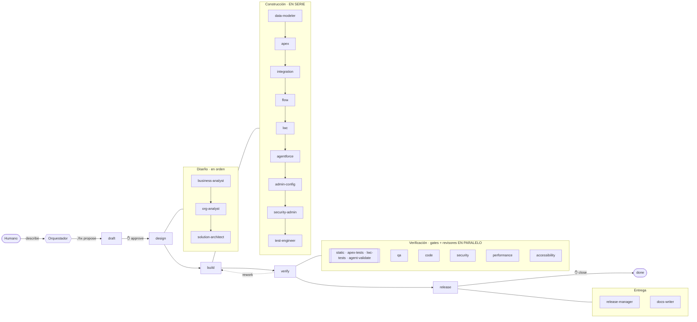

<div align="center">

# ⚡ harness-SF v3

### Ingeniería multiagente para Salesforce sobre Claude Code

*Un orquestador y 19 agentes especializados que diseñan, construyen, verifican y entregan features
de Salesforce. Las reglas no se le piden a los agentes: se les imponen.*

[](https://github.com/guiller91/harness-SF-v3/actions/workflows/harness-ci.yml)


</div>

---

## El problema

Un agente de IA escribe Apex rápido. También despliega cosas que nadie ha revisado, se aprueba a sí
mismo, "arregla" un test para que pase y, si le dejas, apunta a la org equivocada. Pedirle en un
prompt que no lo haga funciona… hasta que deja de funcionar.

**harness-SF** convierte esas peticiones en mecanismos:

| En vez de pedir… | …el harness lo impone |
|---|---|
| "No toques lo que no es tuyo" | Cada tipo de metadata tiene un rol dueño; un hook bloquea cualquier otra escritura |
| "No te salgas del alcance" | El scope de la feature son globs; escribir fuera se bloquea y queda registrado |
| "No programes sin diseño" | El producto solo se puede escribir en fase `build`, y a `build` solo se llega con diseño |
| "Comprueba que funciona" | Sin evidencia de los gates sobre el código **actual**, la feature no avanza |
| "No cambies nada después de revisar" | La evidencia va atada al hash del código: si cambia un fichero, caduca |
| "Solo la org de desarrollo" | Todo comando `sf` se inspecciona: otra org, producción o credenciales → bloqueado |
| "Pregunta antes de lo importante" | Aprobar y cerrar una feature exigen confirmación humana, siempre |
| "Deja escrito lo que has hecho" | Un subagente no puede terminar sin su informe de traspaso |

## Cómo funciona



**El pipeline se deriva del cambio.** No trabajan los 20 agentes en cada feature: `./hx plan` calcula
qué roles, gates y revisiones exige *este* cambio según la metadata que toca. Un trigger no pasa por
el revisor de accesibilidad; un LWC sí.

**El estado vive en disco y solo cambia con `./hx`.** Los agentes no editan `feature_list.json`:
piden la transición a la CLI, que la concede solo si se cumplen los criterios de la puerta.

```console
$ ./hx advance
✗ F-003 NO puede pasar de verify a release:
   - gate apex-tests: fail (bajo el 85%: PedidoService 71%)
   - review security-reviewer: stale (evidencia de otro árbol (3fa9…) ≠ (b21c…); hay que repetir)
   - acceptance.md no traza: AC-4
```

## Los 20 roles

| Fase | Agentes |
|---|---|
| Orquestación | **orchestrator** — única voz con el humano; no escribe producto |
| Diseño | **business-analyst** · **org-analyst** (qué hay ya en la org) · **solution-architect** |
| Construcción | **data-modeler** · **apex-developer** · **integration-developer** · **flow-developer** · **lwc-developer** · **agentforce-developer** · **admin-configurator** · **security-admin** · **test-engineer** |
| Verificación | **qa-verifier** · **code-reviewer** · **security-reviewer** · **performance-reviewer** · **accessibility-reviewer** |
| Entrega | **release-manager** · **docs-writer** |

Detalle de cada uno, modelo asignado y por qué: [`AGENTS.md`](AGENTS.md).

Decisiones de diseño que marcan la diferencia:

- **Quien construye no prueba ni aprueba.** `test-engineer` escribe los tests desde el diseño, no
  desde el código; la matriz de propiedad impide que un implementer toque sus tests.
- **Implementers en serie, revisores en paralelo.** Una org es un recurso compartido: dos deploys a
  la vez se pisan. Leer no colisiona.
- **`org-analyst` antes de diseñar.** En Salesforce casi nada cae en terreno vacío: primero se mira
  qué triggers, flows y validaciones existen ya sobre el objeto.
- **Modelo por rol.** El más capaz donde un error sale caro y ningún gate lo caza (arquitectura,
  seguridad); uno equilibrado donde el resultado se verifica mecánicamente.
- **Conocimiento en skills, no en prompts.** 11 skills de Salesforce (Apex, tests, LWC, Flow, modelo
  de datos, seguridad, integración, Agentforce, rendimiento, CLI, release) que cada agente precarga
  según su rol.

## Gates

| Gate | Qué demuestra |
|---|---|
| `static` | Salesforce Code Analyzer v5 (Apex, LWC, Flows) sin violaciones sobre el umbral |
| `apex-tests` | Tests en verde y cobertura **≥ 85 % por cada clase y trigger que toca la feature** |
| `lwc-tests` | Jest en verde y cada componente cambiado tiene tests |
| `agent-validate` | Cada authoring bundle de Agentforce compila |
| `deploy-validate` | El manifest de la feature valida check-only, con tests |

Además, cada vez que un agente guarda un fichero salta una **revisión instantánea** (SOQL/DML en
bucles, clases sin sharing, `SeeAllData`, Ids a fuego, XML mal formado, permisos amplios,
`innerHTML`…) que le devuelve el hallazgo en segundos, sin esperar al gate.

## Inicio rápido

**Requisitos:** [Claude Code](https://claude.com/claude-code), Salesforce CLI (`sf` v2) con el plugin
`code-analyzer`, Node.js LTS, Python 3.8+, Java 11+ (para PMD), git. En Windows, WSL o Git Bash con
`python3` en el PATH.

```bash
# 1. Usa este repo como plantilla (o instálalo en un proyecto existente: ver más abajo)
git clone https://github.com/guiller91/harness-SF-v3.git mi-proyecto && cd mi-proyecto
npm install && sf plugins install code-analyzer

# 2. Configura: nombre, modelo de org (scratch | sandbox) y alias de la org de desarrollo
$EDITOR harness.config.json

# 3. Autentica TÚ las orgs (los agentes nunca gestionan credenciales)
sf org login web --set-default-dev-hub --alias DevHub      # modelo scratch
./hx org setup                                               # crea la scratch org de desarrollo

# 4. Comprueba entorno, org y coherencia
./hx doctor

# 5. Abre Claude Code y describe lo que quieres
claude
> Quiero que al confirmar un pedido se asigne automáticamente a la cola de su territorio…
```

El orquestador te hará las preguntas que falten, te enseñará la feature para que la apruebes y la
llevará por las cuatro fases. Te volverá a necesitar para cerrar (y, si es grande, para aprobar el
diseño).

**En un proyecto SFDX existente:**

```bash
git clone https://github.com/guiller91/harness-SF-v3.git && ./harness-SF-v3/install.sh /ruta/a/tu-proyecto
```

## La CLI

```
./hx status            estado de la feature activa y siguiente paso
./hx plan              roles, gates y reviews que exige este cambio
./hx propose <json>    registrar un borrador            ./hx approve <id>   ✋ humano
./hx start <id>        abrir la feature (design)        ./hx close <id>     ✋ humano
./hx scope <id> set|add <glob>…                         ./hx advance        siguiente fase
./hx gate run <gate|all>                                ./hx verdict <rol> pass|fail
./hx rework <id> --reason …                             ./hx block|unblock <id>
./hx metrics           lead time, gates a la primera, rework, bloqueos
./hx doctor · ./hx check                                entorno · coherencia interna
```

## Medirlo

`benchmarks/` trae cinco features de referencia (trigger, LWC, flow, integración, agente).
Ejecútalas en tu org y `./hx metrics` te da datos, no impresiones: tiempo por fase, % de gates en
verde a la primera, revisiones rechazadas, ciclos de rework y cuántas veces un guarda paró a un
agente. Repite tras cambiar un prompt o un modelo para saber si mejora.

## Seguridad

Qué bloquea cada guarda, el modo mantenimiento y —sobre todo— **qué no garantiza**:
[`docs/security-model.md`](docs/security-model.md). Resumen honesto: es una barandilla contra
errores y derivas de un agente, no un sandbox frente a un adversario. No autentiques producción en
la máquina donde trabajan los agentes.

## Estado de verificación

| Pieza | Cómo está probada |
|---|---|
| Máquina de estados (`./hx`), evidencia, plan derivado | Tests automáticos (`harness/tests/`), en CI |
| Hooks: propiedad, fase, scope, orgs, git, secretos, traspasos | Tests automáticos con eventos simulados, en CI |
| Evaluador de cobertura por clase | Tests automáticos con los dos formatos de salida de la CLI |
| Gates `static` y `lwc-tests` | Ejecutados de verdad (Code Analyzer v5 y Jest) sobre código de ejemplo |
| Comandos `sf` usados en gates, skills y agentes | Contrastados con `--help` de la CLI 2.157 |
| Gates `apex-tests`, `deploy-validate`, `agent-validate` | Lógica probada; **pendiente de ejecutar contra una org real** |
| Ciclo completo con los 20 agentes dentro de Claude Code | **Pendiente**: para eso están los `benchmarks/` |

```bash
npm run harness:test     # 116 tests del harness
./hx check               # roles ↔ agentes ↔ pipeline ↔ gates ↔ hooks
```

## Personalizar

Cobertura mínima, umbral del analyzer, org → `harness.config.json`. Qué exige cada tipo de cambio →
`harness/pipeline.json`. Quién es dueño de qué → `harness/roles.json`. Normas de tu equipo →
`docs/conventions.md`. Añadir un rol o un gate: [`docs/workflow.md`](docs/workflow.md#personalizar).

El harness se protege a sí mismo: los agentes no pueden editar sus reglas, sus gates ni su
evidencia. Para modificarlo, lanza Claude Code con `HARNESS_MAINTENANCE=1`.

## Documentación

[`CLAUDE.md`](CLAUDE.md) las diez reglas · [`AGENTS.md`](AGENTS.md) roles y árbol ·
[`CHECKPOINTS.md`](CHECKPOINTS.md) qué significa "hecho" · [`docs/workflow.md`](docs/workflow.md)
fases, puertas y traspasos · [`docs/security-model.md`](docs/security-model.md) guardas y límites

---

<div align="center">

Licencia MIT

</div>
